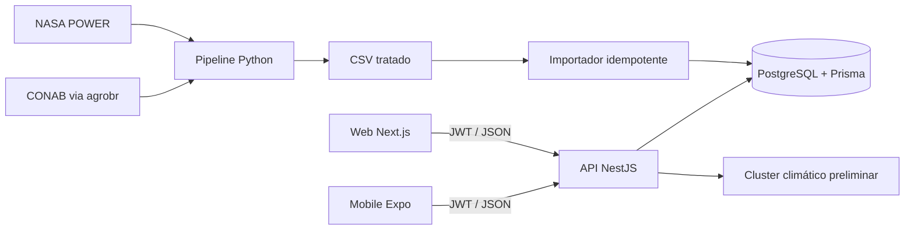

# Plataforma agrícola — Grupo 07

Plataforma multiplataforma de análise de dados agrícolas e climáticos por
município e cultura, desenvolvida pelo Grupo 07 no Projeto Interdisciplinar do 6º semestre
de Desenvolvimento de Software Multiplataforma (DSM 2026/2).

**Integrantes:** Thiago Cunha, Paulo Ricardo, Vinícius de Araújo e Patrícia
Nogueira

**Instituição:** Fatec Franca — “Dr. Thomaz Novelino” (Centro Paula Souza)

## 1. Objetivo do produto

A plataforma organiza dados climáticos e de produção por município e cultura
para apoiar a exploração de resultados analíticos. A solução possui:

- API REST NestJS para autenticação, municípios, clima, produção, culturas, compatibilidade e métricas;
- dashboard Web Next.js integrado à API;
- aplicativo Mobile Expo com login, municípios vinculados e detalhe agrícola;
- PostgreSQL gerenciado por Prisma;
- pipeline analítico em Python para tratamento, coleta e clusterização;
- documentação intermediária da Sprint 2 com as evidências que ainda precisam
  ser anexadas ao relatório.

O rendimento obtido da CONAB é uma referência agregada por UF. Não deve ser
interpretado como medição individual de uma propriedade.

## 2. Critérios de entrega da Sprint 2

| Critério | Situação atual | Evidência obrigatória |
| --- | --- | --- |
| Back-end com CRUD básico | Implementado localmente | Print do Swagger, requisições CRUD e trecho de controller/service |
| Front-end integrado | Web e Mobile integrados para consulta | Print do dashboard e da tela Mobile; trecho do cliente HTTP |
| Banco populado com testes | Implementado localmente pelo seed | Print das tabelas ou Prisma Studio e saída do seed |
| Commits ativos da equipe | Deve ser conferido no GitHub | Print do histórico filtrado por autor |
| Ambiente em nuvem | Pendente de configuração final | Print do provedor, banco, API publicada e configuração inicial |
| Coleta e tratamento | Scripts NASA POWER e CONAB/agrobr criados | Print da execução, CSV tratado, contagens e validações |
| Técnica inicial de mineração | Cluster climático preliminar implementado | Print do resultado, variáveis, `k=2` e métrica do pipeline |
| Documentação intermediária | Mantida em atualização | Prints, links e trechos inseridos em `docs/documentacao-sprint2.md` |

O checklist detalhado e o registro oficial de pendências estão em
[docs/documentacao-sprint2.md](./docs/documentacao-sprint2.md).

## 3. Stack

| Camada | Tecnologia |
| --- | --- |
| API | NestJS 11, Node.js 20+ |
| ORM e banco | Prisma 6 + PostgreSQL 16 |
| Web | Next.js 15, React 19, Tailwind CSS 4 |
| Mobile | React Native, Expo e `expo-secure-store` |
| Analytics | Python, pandas, scikit-learn e Jupyter |
| Infraestrutura local | Docker Compose |
| Fontes externas | NASA POWER e CONAB via pacote `agrobr` |
| Nuvem (base assíncrona) | Azure Blob Storage + Azure Service Bus |

## 4. Estrutura do repositório

```text
/
├── backend/
│   ├── prisma/              # schema, migrations e seed
│   ├── src/                 # módulos NestJS
│   ├── scripts/             # importação idempotente de CSVs tratados
│   └── test/                # testes e2e
├── web/
│   └── src/                 # dashboard Next.js e cliente HTTP
├── mobile/
│   ├── App.tsx              # login, regiões e detalhes
│   └── src/                 # API e sessão segura
├── analytics/
│   ├── notebooks/            # pipeline de mineração
│   ├── scripts/              # coleta NASA POWER e CONAB
│   └── docs/                 # explicações e limitações analíticas
├── docs/
│   ├── documentacao-sprint1.md
│   └── documentacao-sprint2.md
├── docker-compose.yml
└── README.md
```

## 5. Arquitetura



As regras de negócio ficam no back-end ou no pipeline. Web e Mobile não fazem
chamadas diretas à NASA POWER ou à CONAB.

## 6. Configuração local

### Pré-requisitos

- Node.js 20 ou superior;
- Docker Desktop;
- Python 3.11 ou superior para o módulo analítico;
- npm.

### PostgreSQL

Na raiz do projeto:

```powershell
docker compose up -d
```

O Compose cria localmente o banco `cafe_pi` na porta `5432`. Os valores
completos de conexão devem permanecer apenas nos arquivos `.env` locais.

### Back-end

```powershell
Set-Location backend
Copy-Item .env.example .env
npm install
npx prisma generate
npx prisma migrate dev
npm run prisma:seed
npm run start:dev
```

API: `http://localhost:3001`

Swagger: `http://localhost:3001/api`

Scripts principais:

```powershell
npm run build
npm run lint
npm run test
npm run test:e2e
npm run data:import -- clima.csv safra.csv regiao-uf.csv
```

O comando `data:import` valida regiões e realiza upsert de clima por
`regiaoId + data` e de safra por `regiaoId + anoColheita`.

### Azure Blob Storage e Service Bus

A integração assíncrona é ativada somente com
`AZURE_INTEGRATION_ENABLED=true`. O comando `data:publish` armazena um CSV
tratado no container privado `data-treated` e publica um evento versionado
`DataFileAvailable` na fila do Azure Service Bus. O consumidor do backend baixa
o blob, reutiliza o importador idempotente e confirma a mensagem apenas após o
processamento.

O script de provisionamento reproduzível está em
[`infra/azure/provision.ps1`](./infra/azure/provision.ps1). Em produção,
Blob Storage e Service Bus usam Managed Identity/Entra ID com RBAC. Connection
strings são aceitas somente no desenvolvimento local por variáveis de
ambiente não versionadas. O recurso Azure ainda precisa ser criado para que
as evidências de publicação sejam consideradas concluídas.

### Web

```powershell
Set-Location web
Copy-Item .env.example .env
npm install
npm run dev
```

Web: `http://localhost:3000`

Variável necessária:

```env
NEXT_PUBLIC_API_URL=http://localhost:3001
```

Validação:

```powershell
npm run lint
npm run build
```

### Mobile

```powershell
Set-Location mobile
Copy-Item .env.example .env
npm install
npx tsc --noEmit
npm run start
```

Para um dispositivo físico, `EXPO_PUBLIC_API_URL` deve apontar para o IP da
máquina na rede local, e não para `localhost`.

## 7. API e autenticação

Todas as rotas abaixo exigem JWT, exceto login e cadastro.

| Método | Endpoint | Acesso | Finalidade |
| --- | --- | --- | --- |
| `POST` | `/auth/login` | Público | Emite JWT |
| `POST` | `/auth/register` | Público | Cadastra produtor |
| `GET` | `/regioes?q=&uf=&cultura=&page=&limit=` | Autenticado | Lista municípios paginados; PRODUTOR vê apenas seus vínculos |
| `GET` | `/regioes/:id` | Autenticado | Detalhe do município |
| `POST` | `/regioes/:id/usuarios/:userId` | `ADMIN` | Vincula usuário a município |
| `POST` | `/regioes` | `ADMIN`, `TECNICO` | Cria região |
| `PATCH` | `/regioes/:id` | `ADMIN`, `TECNICO` | Atualiza região |
| `DELETE` | `/regioes/:id` | `ADMIN` | Remove região |
| `GET` | `/clima/municipios/:id` | Autenticado | Climatologia anual e sazonal |
| `GET` | `/clima/:regiaoId?de=&ate=` | Autenticado | Série diária legada por período |
| `POST` | `/clima` | `ADMIN`, `TECNICO` | Cria observação climática |
| `PATCH` | `/clima/:id` | `ADMIN`, `TECNICO` | Atualiza observação |
| `DELETE` | `/clima/:id` | `ADMIN` | Remove observação |
| `GET` | `/safra/:regiaoId?ano=` | Autenticado | Consulta safra por ano |
| `POST` | `/safra` | `ADMIN`, `TECNICO` | Cria rendimento |
| `PATCH` | `/safra/:id` | `ADMIN`, `TECNICO` | Atualiza rendimento |
| `DELETE` | `/safra/:id` | `ADMIN` | Remove rendimento |
| `GET` | `/clusters` | Autenticado | Consulta clusters persistidos |
| `GET` | `/clusters/:id` | Autenticado | Perfil do município |
| `GET` | `/culturas` | Autenticado | Catálogo de culturas |
| `GET` | `/compatibilidades/:regiaoId` | Autenticado | Compatibilidade por município |
| `GET` | `/compatibilidades?cultura=&min=&uf=&page=&limit=` | Autenticado | Ranking paginado de municípios |
| `GET` | `/modelos/metricas` | Autenticado | Métricas por cultura e versão |

Exemplo de login:

```http
POST /auth/login
Content-Type: application/json

{
  "email": "usuario@exemplo.com",
  "senha": "senha-local"
}
```

Exemplo de criação de clima:

```http
POST /clima
Authorization: Bearer <JWT>
Content-Type: application/json

{
  "regiaoId": "<id-da-regiao>",
  "data": "2024-01-15",
  "temperaturaMedia": 23.5,
  "precipitacao": 120.4,
  "umidade": 68.2,
  "radiacaoSolar": 5.7
}
```

O token acima é apenas um marcador de documentação. Não registrar tokens,
senhas ou chaves reais no repositório.

## 8. Front-end integrado

### Web

O dashboard em
[web/src/app/dashboard/page.tsx](./web/src/app/dashboard/page.tsx) oferece:

- seleção de região;
- filtro de clima por período;
- filtro de safra por ano;
- indicadores de temperatura, chuva e rendimento;
- série visual de temperatura;
- histórico de safras;
- clusters climáticos e explicação da métrica;
- estados de carregamento, erro e ausência de dados.

O contrato tipado está em
[web/src/lib/api.ts](./web/src/lib/api.ts).

### Mobile

O aplicativo em [mobile/App.tsx](./mobile/App.tsx) oferece:

- login com armazenamento seguro;
- lista de regiões;
- seleção de região;
- detalhes de clima e safra;
- indicadores recentes;
- estados de carregamento, erro e vazio.

CRUD administrativo no Mobile permanece fora do escopo da integração inicial.

## 9. Dados e mineração

### Coleta climática

O script
[coletar_nasa_power.py](./analytics/scripts/coletar_nasa_power.py) consulta
temperatura, precipitação, umidade e radiação solar por latitude e longitude.

```powershell
Set-Location analytics
python scripts\coletar_nasa_power.py `
  --regions data\regions.csv `
  --output data\processed\clima_nasa.csv `
  --start 20240101 `
  --end 20241231
```

### Coleta de safra

O script [coletar_conab.py](./analytics/scripts/coletar_conab.py) usa
`agrobr.sync.conab.safras`, consulta café por safra e UF e converte
produtividade de kg/ha para toneladas/ha.

```powershell
Set-Location analytics
python scripts\coletar_conab.py `
  --output data\processed\safra_conab.csv `
  --safra 2024/25 `
  --uf MG
```

### Tratamento e cluster

O pipeline analítico segue a ordem:

```text
00_preprocessamento → 02_correlacao → 03_kmeans → 04_classificacao → 01_ingestao (exportação JSON)
```

O notebook 01 exporta um artefato versionado para o importador do backend; ele não grava diretamente no banco. O endpoint `/clusters/:id` consulta os grupos persistidos pelo pipeline.

O notebook 03 calcula o agrupamento climático; a API consulta os resultados persistidos por município. As variáveis usadas são:

- temperatura média;
- precipitação média;
- umidade média;
- radiação solar média.

O resultado atual é exploratório. A previsão de produtividade permanece
reservada para a Sprint 3, pois as bases atuais não formam uma série observada
de café por região e ano suficiente para uma previsão confiável.

## 10. Critérios para prints e trechos de código

Os prints devem mostrar contexto suficiente para identificar o projeto, a rota,
o resultado e a data da evidência. Ocultar tokens, senhas, URLs privadas,
chaves e dados pessoais.

### Prints obrigatórios

1. **Back-end/Swagger**
   - Swagger em `/api`;
   - endpoint aberto com método, rota e payload;
   - resposta HTTP de sucesso;
   - pelo menos um erro de validação ou recurso inexistente.
2. **Front-end Web**
   - login;
   - dashboard com região selecionada;
   - filtro de período/ano;
   - série climática, safra e cluster;
   - aba Network mostrando a chamada para a API sem expor o JWT.
3. **Mobile**
   - login;
   - lista de regiões;
   - detalhe de clima e safra;
   - estado de erro ou ausência de dados, quando aplicável.
4. **Banco**
   - PostgreSQL/Prisma Studio com `Regiao_Produtora`,
     `Condicao_Climatica` e `Safra_Rendimento`;
   - saída do `prisma:seed`;
   - evidência de reexecução sem duplicidade.
5. **Analytics**
   - execução dos scripts de coleta;
   - CSV tratado;
   - notebook com tratamento;
   - gráfico ou saída do K-Means;
   - variáveis, `k=2`, quantidade de regiões e silhouette quando disponível.
6. **Nuvem**
   - provedor e recurso criado;
   - banco e API disponíveis;
   - configuração inicial sem mostrar credenciais;
   - teste da API publicada.
7. **GitHub**
   - histórico de commits;
   - autores identificáveis;
   - branch ou pull request correspondente.

### Trechos de código recomendados

Cada trecho deve conter caminho do arquivo e contexto suficiente para
identificar a implementação. Recomenda-se anexar:

- controller e DTO do CRUD;
- `web/src/lib/api.ts` com o cliente tipado;
- trecho do dashboard que chama clima, safra e clusters;
- `mobile/src/api.ts` e armazenamento da sessão;
- `analytics/scripts/coletar_nasa_power.py`;
- `analytics/scripts/coletar_conab.py`;
- `backend/scripts/import-tratados.ts`;
- `backend/prisma/schema.prisma`;
- teste e2e de autenticação ou CRUD.

Modelo para registrar cada evidência:

```text
EVIDÊNCIA E-01 — Dashboard Web
Arquivo/rota: web/src/app/dashboard/page.tsx
Objetivo: demonstrar filtro de período e consumo da API
Print: docs/evidencias/sprint2-dashboard.png
Comando/teste: cd web; npm run build
Resultado: aprovado
```

## 11. Validação antes da entrega

Executar:

```powershell
Set-Location backend
npm run build
npm run lint
npm run test:e2e

Set-Location ..\web
npm run lint
npm run build

Set-Location ..\mobile
npx tsc --noEmit

Set-Location ..\analytics
python -m py_compile scripts\coletar_nasa_power.py scripts\coletar_conab.py
```

Também executar `git diff --check` antes do commit.

## 12. Documentação complementar

- [Documentação da Sprint 1](./docs/documentacao-sprint1.md)
- [Documentação geral da Sprint 2](./docs/documentacao-sprint2.md)
- [README do back-end](./backend/README.md)
- [README do Web](./web/README.md)
- [README do Mobile](./mobile/README.md)
- [README de analytics](./analytics/README.md)
- [Explicação do pré-processamento](./analytics/docs/explicacao-preprocessamento.md)
- [Regras do Copilot](./.github/copilot-instructions.md)

## 13. Política de segurança e Git

- Não versionar `.env`, senhas, tokens, chaves privadas ou arquivos sensíveis.
- Commits e pushes somente mediante solicitação explícita.
- Revisar os arquivos staged antes do commit.
- Manter a documentação da Sprint 2 atualizada em toda alteração do projeto.
