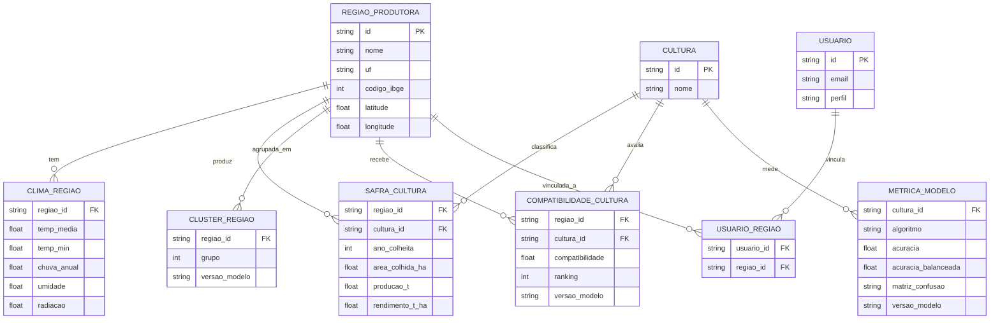
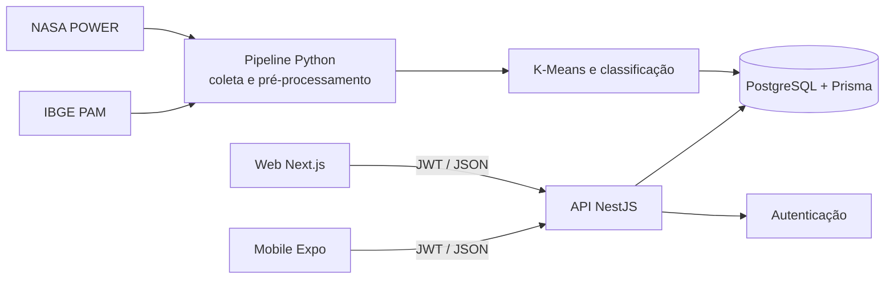
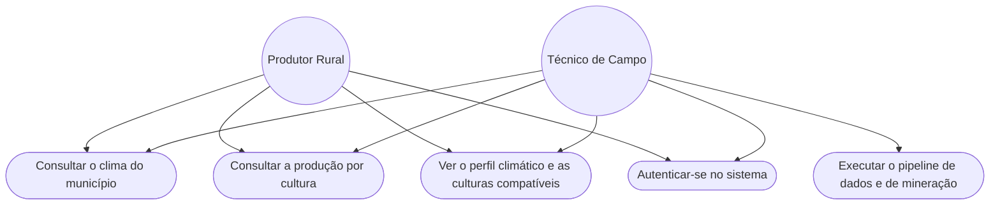

# Documentação do Projeto Interdisciplinar

## Plataforma de Mineração de Dados Agrícolas e Climáticos do Café

**Instituição:** Faculdade de Tecnologia de Franca "Dr. Thomaz Novelino" (Centro Paula Souza)

**Curso:** Desenvolvimento de Software Multiplataforma (DSM) · **Grupo:** DSM-G07

**Repositório:** github.com/FatecFranca/DSM-G07-PI6-2026-2

| Sprint | Data | Foco |
| --- | --- | --- |
| 1ª Sprint | 04/09/2026 | Escopo, requisitos, modelagem, arquitetura, estrutura inicial e planejamento |
| 2ª Sprint | 09/10/2026 | Versão intermediária com integrações parciais |

Este documento reúne em um só lugar o que antes estava em `documentacao-sprint1.md` e `documentacao-sprint2.md`. Ele descreve o que foi **planejado** na Sprint 1, o que foi **implementado** na Sprint 2 e o que **mudou no caminho** (principalmente na parte de dados e de mineração). Onde algo não foi concluído, isso está dito.

---

## 1. Visão geral e evolução do projeto

O projeto é uma solução **multiplataforma** (Web e Mobile) de mineração de dados agrícolas e climáticos. A plataforma cruza dados de clima com dados de produção agrícola para indicar, para cada município, **quais culturas combinam com o seu clima**, com destaque para o café, e entrega os resultados em um dashboard web e em um aplicativo mobile.

### 1.1. O que mudou desde a Sprint 1

Durante a Sprint 2, a parte de dados e de mineração foi refeita, porque as bases planejadas não permitiam responder bem à pergunta do projeto (o *Agriculture Crop Yield* não tem região nem ano, e a previsão de produtividade de café por clima mostrou desempenho fraco).

| | Planejado na Sprint 1 | Situação atual |
| --- | --- | --- |
| Unidade de análise | Região produtora de café | **Município** (1.576 de ES, MG e SP) |
| Culturas | Só café | **Seis culturas**: café, cana-de-açúcar, soja, milho, laranja e feijão |
| Fontes de dados | Coffee Data Set e Agriculture Crop Yield (Kaggle) | **NASA POWER** (clima) e **IBGE, Produção Agrícola Municipal** |
| Clima | Série diária por região | **Climatologia** (média de longo prazo) por município |
| Técnica supervisionada | Regressão (estimar produtividade em t/ha) | **Classificação** ("o município é apto para a cultura?") |
| Técnica não supervisionada | K-Means | K-Means (mantido) |
| Saída para o usuário | Cluster e predição de produtividade | Cluster e **compatibilidade por cultura**, com ranking e métricas |

A passagem completa dos requisitos, do banco e das telas para o novo formato está em `plano-adaptacao-projeto.md`. As partes **já implementadas** (analytics, back-end, web, mobile e banco de testes) seguem o formato anterior em alguns pontos, e isso está indicado em cada seção.

## 2. Checklist de conformidade

### 2.1. Entregas mínimas da Sprint 1

| Entrega | Status | Seção |
| --- | --- | --- |
| Definição do escopo e requisitos (funcionais e não funcionais) | Concluído | 3 |
| Modelagem inicial (casos de uso, arquitetura) | Concluído | 5 e 6 |
| Criação do repositório do grupo no GitHub | Concluído | 7.5 |
| Estrutura inicial do back-end (framework e API) | Concluído | 7.1 |
| Protótipo inicial do front-end | Concluído | 7.2 |
| Banco de dados modelado (conceitual e lógico) | Concluído | 5 |
| Computação em Nuvem II: definição e justificativa dos serviços | Concluído | 8.1 |
| Mineração de dados: definição da base e planejamento das técnicas | Concluído e revisado | 9 |

### 2.2. Entregas mínimas da Sprint 2

| Entrega | Status | Evidência |
| --- | --- | --- |
| Back-end com endpoints básicos da API (CRUD) | Concluído no ambiente local | E-01 |
| Front-end integrado parcialmente ao back-end | Integrado no Web | E-02 |
| Aplicativo mobile consumindo a API | Integrado para consulta | E-03 |
| Banco de dados implementado e populado com dados de teste | Concluído (local e no Azure) | E-04 |
| Commits ativos de todos os integrantes no GitHub | Histórico registrado; conferir no GitHub | E-05 |
| Ambiente em nuvem criado (mesmo que parcialmente) | **Parcial:** banco PostgreSQL no Azure criado e populado; API ainda não publicada | E-06 |
| Documentação da configuração inicial da nuvem | Concluída para o ambiente parcial (seção 8.2) | E-06 |
| Coleta e tratamento dos dados | Concluído (scripts e notebook executados) | E-07 |
| Técnica inicial de mineração de dados | Concluído (K-Means e classificação executados) | E-08 |
| Documentação intermediária com evidências | Este documento | — |

## 3. Escopo e requisitos

### 3.1. Requisitos funcionais

A coluna **Situação** indica o estado atual. A descrição já está na versão atualizada (formato de municípios e culturas); quando o requisito original era diferente, a mudança é citada.

#### RF01 — Ingestão e consolidação de dados

| Requisito | Descrição | Situação |
| --- | --- | --- |
| RF01.1 | Coletar por script Python o clima (NASA POWER) e a produção agrícola por município e cultura (IBGE PAM). *Originalmente: importar os CSV do Coffee Data Set e do Agriculture Crop Yield (Kaggle).* | Feito |
| RF01.2 | Identificar e tratar nulos, duplicados e inconsistências antes da persistência | Feito |
| RF01.3 | Relacionar as bases pelo **código do município (IBGE)**. *Originalmente: por regressão entre duas bases sem chave em comum.* | Feito |
| RF01.4 | Persistir os dados consolidados no banco relacional | Parcial: importadores existem; faltam as tabelas do novo modelo (seção 5.3) |

#### RF02 — Mineração de dados (módulo analítico em Python)

| Requisito | Descrição | Situação |
| --- | --- | --- |
| RF02.1 | Gerar matrizes de correlação entre o clima e a área colhida de cada cultura | Feito |
| RF02.2 | Aplicar K-Means para segmentar os municípios por perfil climático | Feito |
| RF02.3 | Aplicar **classificação supervisionada** (apto ou não apto por cultura). *Originalmente: regressão para estimar a produtividade.* | Feito |
| RF02.4 | Armazenar os resultados de clusterização e de classificação vinculados ao município (com versão do modelo) | Pendente: os resultados estão em arquivos CSV |

#### RF03 — API RESTful (NestJS)

| Requisito | Descrição | Situação |
| --- | --- | --- |
| RF03.1 | `GET /regioes`, com filtro por país | Feito (a ampliar com UF, busca e paginação) |
| RF03.2 | `GET /clima/:regiaoId`, retornando o clima da região | Feito (série diária; a adaptar para a climatologia) |
| RF03.3 | `GET /safra/:regiaoId`, retornando o histórico de rendimento | Feito (a adaptar para cultura, área e produção) |
| RF03.4 | `GET /clusters`, retornando o agrupamento | Parcial: o K-Means é calculado na própria API de forma provisória |
| RF03.5 | Compatibilidade de culturas por município (`GET /compatibilidades/:regiaoId`). *Originalmente: `GET /predicoes/:regiaoId` (estimativa de produtividade).* | Pendente |
| RF03.6 | Documentar os endpoints via OpenAPI/Swagger | Feito |
| RF03.7 | Exigir autenticação JWT, exceto login e cadastro | Feito |

#### RF04 — Interface web (Next.js)

| Requisito | Descrição | Situação |
| --- | --- | --- |
| RF04.1 | Listar as regiões e permitir a seleção individual | Feito (com dados de teste) |
| RF04.2 | Gráficos de temperatura, precipitação e rendimento da região | Parcial: série de temperatura e histórico de safra |
| RF04.3 | Exibir o agrupamento (clusters) com legenda por perfil climático | Parcial: exibe o cluster da região |
| RF04.4 | Exigir login antes de exibir os dados | Feito |
| RF04.5 | Filtrar por período de clima e ano de safra | Feito |

#### RF05 — Aplicativo mobile (React Native / Expo)

| Requisito | Descrição | Situação |
| --- | --- | --- |
| RF05.1 | Login do produtor ou técnico com o mesmo JWT da API | Feito |
| RF05.2 | Exibir clima recente e histórico de rendimento da região | Feito |
| RF05.3 | Exibir o cluster e a compatibilidade de culturas da região | Pendente |
| RF05.4 | Cache local para consulta parcial offline | Pendente |

#### RF06 — Usuários e permissões

| Requisito | Descrição | Situação |
| --- | --- | --- |
| RF06.1 | Cadastro de usuários com perfis Administrador, Técnico e Produtor | Feito (cadastro e login) |
| RF06.2 | Restringir o acesso por perfil: o Produtor vê só as regiões vinculadas; o Técnico, várias; o Administrador, todas | Parcial: a relação usuário-região existe, mas a API ainda **não filtra** pelo vínculo |

### 3.2. Requisitos não funcionais

| Requisito | Descrição | Situação |
| --- | --- | --- |
| RNF01 (Nuvem) | Infraestrutura em nuvem pública | Parcial: banco no Azure; API ainda não publicada |
| RNF02 (Arquitetura) | Conteinerização com Docker | Parcial: Postgres em `docker-compose`; API e Web ainda sem contêiner |
| RNF03 (Segurança) | APIs protegidas por autenticação, sem expor o banco diretamente aos clientes | Feito para a API (JWT). O banco no Azure usa acesso público restrito por IP |
| RNF04 (Multiplataforma) | Mobile em Android e iOS com uma base de código | Feito (Expo) |
| RNF05 (Usabilidade mobile) | Interface leve para conectividade limitada | Parcial: depende do cache (RF05.4) |

## 4. Regras de negócio

1. **Domínio:** a plataforma cruza o **clima do município** com as **culturas cultivadas** (área colhida) para indicar a **compatibilidade de culturas**, com destaque para o café.
2. **Persistência:** os dados só são persistidos depois do pré-processamento (nulos, duplicados, inconsistências e outliers documentados).
3. **Chave de ligação:** o **código do município (IBGE)** liga o clima e as culturas. A série de safra usa município, cultura e ano.
4. **Significado dos resultados:** "apto" quer dizer que o município **já cultiva** a cultura em escala relevante (área média de 500 ha ou mais, de 2015 a 2024). **Não** é uma previsão de produtividade nem uma garantia de que "pode plantar". A interface deve exibir o aviso, a fonte e o ano do dado.
5. **Acesso (RF06):** o Produtor vê só os municípios vinculados; o Técnico vê os municípios sob sua responsabilidade; o Administrador tem acesso irrestrito.
6. **API:** JWT em todas as rotas, exceto `POST /auth/login` e `POST /auth/register`. Web e Mobile usam a **mesma API**, sem duplicar regra de negócio.
7. **Quem calcula os resultados:** o pipeline Python calcula e grava (com a versão do modelo e a data); a API só lê e entrega.
8. **Qualidade do modelo:** sempre reportar matriz de confusão, acurácia, *baseline*, acurácia balanceada, precisão e recall.
9. **Stack:** NestJS, Next.js, Prisma e PostgreSQL. Não trocar sem acordo do grupo.

## 5. Modelagem de dados e banco

O banco é relacional (**PostgreSQL**), modelado com o **Prisma ORM**.

### 5.1. Modelo implementado (Prisma)

| Modelo | Campos principais |
| --- | --- |
| `Usuario` | id, e-mail (único), senha (hash), nome, perfil (`ADMIN`, `TECNICO` ou `PRODUTOR`) |
| `RegiaoProdutora` | id, nome, país, latitude e longitude |
| `CondicaoClimatica` | id, região, data, temperatura média, precipitação, umidade e radiação solar |
| `SafraRendimento` | id, região, ano da colheita, dias de crescimento e rendimento em t/ha (único por região e ano) |
| Relação `Usuario` – `RegiaoProdutora` | N:N, usada pela regra de acesso (RF06.2) |

### 5.2. Modelo conceitual planejado na Sprint 1

A Sprint 1 previa também `Pais`, `Variedade_Cafe`, `Cluster_Climatico`, `Regiao_Cluster` e `Predicao_Produtividade`. Essas entidades **não foram implementadas** no schema atual. As de cluster e predição serão substituídas pelo modelo da seção 5.3, e `Pais` e `Variedade_Cafe` deixam de ser necessárias (o país é um campo de texto e as culturas passam a ser uma tabela própria).

### 5.3. Modelo-alvo (formato de municípios e culturas)

Mudanças em relação ao modelo implementado: `RegiaoProdutora` ganha código IBGE e UF; `SafraRendimento` ganha cultura, área e produção; a série diária de clima é substituída pela climatologia; entram `Cultura`, `ClusterRegiao`, `CompatibilidadeCultura` e `MetricaModelo`.

## 6. Arquitetura e diagramas

- **Web:** Next.js (React), integrado à API.
- **Mobile:** React Native com Expo, consumindo os mesmos endpoints da API.
- **Back-end:** NestJS (Node.js), com autenticação JWT e acesso ao banco pelo Prisma.
- **Módulo analítico:** scripts e notebooks em Python (coleta, pré-processamento, K-Means e classificação). Na Sprint 1 previa-se que a API acionasse os scripts; na implementação o pipeline roda **separado** e grava os resultados, e a API apenas os lê.

### 6.1. Arquitetura

### 6.2. Casos de uso

## 7. Implementação (Sprint 2)

### 7.1. Back-end (NestJS)

**Módulos:** regiões produtoras, condições climáticas, safras e rendimentos, usuários e autenticação.

| Recurso | Operações | Perfis |
| --- | --- | --- |
| `/regioes` | `GET`, `POST`, `PATCH`, `DELETE` | `GET` para qualquer usuário autenticado; criar e alterar: Administrador e Técnico; excluir: Administrador |
| `/clima/:regiaoId` e `/clima` | `GET` (com `de` e `ate`), `POST`, `PATCH`, `DELETE` | mesmas regras |
| `/safra/:regiaoId` e `/safra` | `GET` (com `ano`), `POST`, `PATCH`, `DELETE` | mesmas regras |
| `/clusters` | `GET` (K-Means provisório calculado na API) | autenticado |
| `/auth/login` e `/auth/register` | `POST` | públicos |

**Autenticação e validação:** JWT em todas as rotas privadas; DTOs validados com `class-validator`; erros de validação e recursos inexistentes retornam status HTTP apropriados. A API não expõe o banco diretamente aos clientes.

**Validação técnica:** `npm run build`, `npm run lint` e quatro testes e2e aprovados.

**Ponto conhecido a corrigir:** o filtro de ano da safra falha com o erro "ano must not be less than 1900, ano must be an integer number", porque o parâmetro de consulta chega como texto e os DTOs não convertem o tipo (falta `@Type(() => Number)`).

**Nota de compilação:** o `backend/tsconfig.json` considera só `backend/src`. Os testes e2e ficam em `backend/test/` com configuração própria do Jest. Os campos obrigatórios do `CreateSafraDto` usam a asserção de atribuição definitiva (`!`), pois o NestJS os preenche em tempo de execução a partir do payload validado.

### 7.2. Front-end web (Next.js)

| Tela ou funcionalidade | Integração | Observação |
| --- | --- | --- |
| Login | Integrado | `POST /auth/login`, sessão JWT |
| Lista de regiões | Integrado | `GET /regioes` |
| Condições climáticas | Integrado | `GET /clima/:regiaoId?de=...&ate=...` |
| Dados de safra | Integrado | `GET /safra/:regiaoId?ano=...` |
| Dashboard | Integrado | Clima, safra e cluster, com filtros, séries visuais e estados de carregamento, vazio e erro |

**Critérios técnicos:** usar os endpoints oficiais da API; não duplicar regra de negócio nos componentes; tratar carregamento, sucesso e erro; estilos com Tailwind CSS; URLs e credenciais por variáveis de ambiente.

**Hidratação:** o dashboard espera a hidratação do cliente antes de ler a sessão do `localStorage` e de redirecionar usuários sem autenticação, evitando diferença entre o HTML do servidor e o do navegador.

**Validação técnica:** `npm run lint` e `npm run build`. O cliente tipado está em `web/src/lib/api.ts` e a sessão em `web/src/lib/session.ts`.

### 7.3. Aplicativo mobile (Expo)

O projeto está em `mobile/`, com TypeScript, `EXPO_PUBLIC_API_URL`, login, consulta de regiões, logout, armazenamento seguro do JWT (`expo-secure-store`) e detalhe de clima e safra por região. Mostra o aviso de que o rendimento é uma referência regional. Pendentes: CRUD para Administrador e Técnico, cluster e compatibilidade de culturas, cache offline e extração dos contratos HTTP para um módulo compartilhado entre Web e Mobile.

### 7.4. Banco de dados e dados de teste

O schema é gerenciado pelo Prisma. A carga local é feita com `npx prisma migrate deploy` e `npm run prisma:seed`. O seed cria **dados de teste** (não reais): 3 regiões, 1 medição de clima por região, 1 safra por região e 1 usuário técnico de desenvolvimento. Os registros respeitam as relações do schema, e a carga pode ser repetida sem duplicar. O `backend/scripts/import-tratados.ts` importa arquivos tratados de forma idempotente.

### 7.5. Repositório e boas práticas

O desenvolvimento fica no repositório oficial do grupo no GitHub. Boas práticas adotadas: commits que descrevem a alteração, fluxo de branches definido pelo grupo, *pull requests* com objetivo e arquivos alterados, e nenhum token, senha ou `.env` versionado. O histórico do GitHub é a evidência da participação da equipe.

## 8. Computação em nuvem

### 8.1. Planejamento (Sprint 1)

- **Computação:** Azure, com contêineres para os serviços web (Nest e Next), o motor de mineração (Python) e o back-end consumido pelo mobile.
- **Integração contínua:** pipelines automatizados (por exemplo, GitHub Actions) para o back-end e os builds Android e iOS.
- **Banco de dados:** isolado, com regras de rede estritas, acessado só pelo back-end.

### 8.2. Execução (Sprint 2): ambiente parcial

| Item | Configuração |
| --- | --- |
| Provedor | Microsoft Azure (Azure for Students) |
| Região | Brazil South |
| Serviço | Azure Database for PostgreSQL Flexible Server (camada Burstable, `Standard_B1ms`) |
| Versão | PostgreSQL 16 |
| Forma de implantação | Azure CLI (`az postgres flexible-server create`) |
| Acesso | Público, restrito por regra de firewall ao IP do administrador |
| API | **Não publicada** (roda localmente e se conecta ao banco da nuvem nas cargas) |
| Variáveis de ambiente | `DATABASE_URL` (valor não registrado) |

**Procedimento realizado:** (1) assinatura Azure for Students com o e-mail institucional; (2) login pelo Azure CLI; (3) criação do Resource Group `rg-cafe-pi6`; (4) registro do provedor `Microsoft.DBforPostgreSQL`; (5) criação do servidor `pg-cafe-pi6-g07`; (6) migrations e seed no banco da nuvem; (7) conferência dos dados pelo Prisma Studio.

**Limitações e custo:** a API não está publicada, e o seed contém dados de teste. O crédito do Azure for Students é de US$ 100, com validade de 12 meses. A camada Burstable é indicada para desenvolvimento e testes.

**Evidências a anexar** em `docs/evidencias/` existem os prints de `nuvem-recurso` (grupo de recursos, visão geral do servidor e regras de rede) e `nuvem-servico.png` (migrations e seed e dados no Prisma Studio).

**Próximo passo:** publicar a API (por exemplo, no App Service), com `DATABASE_URL` e `JWT_SECRET` configurados e o comando `npm run start:prod`.

## 9. Mineração de dados

### 9.1. Do planejamento à implementação

A Sprint 1 planejou unir o *Agriculture Crop Yield* e o *Coffee Data Set* (Kaggle), aplicar K-Means e, na etapa seguinte, uma regressão para estimar a produtividade. A implementação mostrou três problemas:

- O *Agriculture Crop Yield* mistura culturas e não tem região nem ano, então a ligação era feita por transferência de modelo. Das 25 regiões de café, 23 tinham chuva anual acima da faixa vista no treino, e as estimativas ficavam quase iguais (6,7 a 6,9 t/ha). O R² de 0,59 valia para o *Crop Yield* e não para o café.
- Com produtividade **real** de café, o clima sozinho explicou pouco: com dados da CONAB por estado, R² de cerca de 0,10 e negativo em anos futuros; com dados do IBGE por município, R² de no máximo 0,14 em anos futuros.
- Os dados do IBGE e da NASA permitiam uma pergunta que os dados sustentam melhor: **a compatibilidade do clima do município com cada cultura**.

Por isso o projeto passou a usar NASA POWER e IBGE (PAM) e a classificação supervisionada.

### 9.2. Bases e coleta

| Base | Conteúdo | Tamanho | Script |
| --- | --- | --- | --- |
| NASA POWER | Climatologia de cada município: temperatura, chuva, umidade e radiação solar | 1.576 municípios (ES, MG e SP) | `coletar_clima_municipios.py` |
| IBGE, PAM | Área colhida, produção e rendimento por município, cultura e ano (2001–2024) | 152.797 linhas, 6 culturas | `coletar_ibge_pam.py` |
| Localização | Latitude e longitude dos municípios (`kelvins/municipios-brasileiros`) | 5.571 municípios, 1.576 usados | (baixada pelo script de clima) |

### 9.3. Pré-processamento

O detalhamento está em `documentacao-preprocessamento.md`. Em resumo:

| Etapa | Resultado |
| --- | --- |
| Seleção de colunas | Municípios de 5.571 para 1.576; colunas da lista de municípios de 9 para 5 |
| Nulos | Clima: 0. PAM: 11 rendimentos vazios (área ou produção zero), mantidos |
| Duplicados | 0 |
| Inconsistências | 0 violações das regras de domínio |
| Outliers | Contados (chuva 8,12%) e **mantidos**, por serem eventos reais |
| Novas variáveis | `chuva_anual`, `amplitude_termica` e `contraste_chuva` |
| Rótulos | "Apto" = área média de 2015 a 2024 de pelo menos 500 ha (café 369, cana 556, soja 453, milho 558, laranja 161 e feijão 170) |
| Padronização | `StandardScaler` dentro dos modelos, ajustado só no treino |
| Resultado | Tabela única de 1.576 municípios por 31 colunas |

### 9.4. Técnicas aplicadas e resultados

Notebooks em `analytics/notebooks/`: `00_preprocessamento`, `02_correlacao`, `03_kmeans` e `04_classificacao` (executados) e `01_ingestao` (carga no banco, depende do Postgres).

**Correlação (Spearman).** As correlações do clima com a área colhida são moderadas. A cana tem as maiores (radiação 0,53, umidade −0,51 e temperatura média 0,49). O café tem correlações fracas (até 0,12 em módulo), o que indica dependência da combinação de variáveis.

**K-Means (não supervisionado).** Agrupa os municípios pelo perfil climático, sem usar a cultura. Melhor valor: k = 7, com silhouette de 0,334 (separação moderada). Por exemplo, um dos grupos concentra 55% de municípios com café e outro, 88% com cana.

**Classificação (supervisionada).** Para cada cultura, um modelo responde "apto ou não apto" com o clima e a localização. Foram comparados três algoritmos (regressão logística, Random Forest e Gradient Boosting) com **validação espacial**: os municípios são agrupados em células de 1° e células iguais nunca ficam em treino e teste ao mesmo tempo. O melhor modelo de cada cultura foi escolhido pela acurácia balanceada.

| Cultura | Melhor modelo | Baseline | Acurácia | Acurácia balanceada | AUC |
| --- | --- | --- | --- | --- | --- |
| Cana-de-açúcar | Gradient Boosting | 64,7% | **91,8%** | 90,6% | 0,948 |
| Café | Random Forest | 76,6% | **87,9%** | 81,1% | 0,903 |
| Soja | Random Forest | 71,3% | 80,3% | 79,2% | 0,896 |
| Milho | Gradient Boosting | 64,6% | 73,4% | 69,9% | 0,776 |
| Laranja | Regressão logística | 89,8% | 73,6% | 80,1% | 0,816 |
| Feijão | Regressão logística | 89,2% | 67,8% | 66,5% | 0,680 |

O *baseline* é a acurácia de responder sempre "não apto". Laranja e feijão são raros (cerca de 10% dos municípios), e os modelos foram balanceados para encontrá-los, o que mantém um recall alto e reduz a acurácia. **Matriz de confusão do café:** 1.134 verdadeiros negativos, 73 falsos positivos, 117 falsos negativos e 252 verdadeiros positivos. As matrizes de todas as culturas estão em `data/processed/matrizes_confusao.png`.

**Cultura dominante (multiclasse).** Acurácia de 72% (baseline 36,9%) e acurácia balanceada de 51%. É um problema mais difícil que o sim ou não.

**Recomendação por município.** A compatibilidade de cada cultura é a probabilidade de "apto", calculada fora da amostra, para os 1.576 municípios e as 6 culturas, com ranking (`compatibilidade_culturas.csv`).

### 9.5. Limitações

1. **"Apto" é medido pela área plantada que já existe**, que depende também de mercado, tradição e tamanho do município.
2. O clima da NASA tem cerca de 50 km de resolução e **não enxerga altitude, solo nem relevo**.
3. Cobertura limitada a ES, MG e SP.
4. O limite de 500 ha é uma escolha do grupo (foi testada a sensibilidade a 200 e 1.000 ha).
5. Laranja e feijão têm baixa precisão.
6. Os resultados estão em arquivos; a integração ao banco, à API e às telas ainda não foi feita.

## 10. Pendências e próximos passos

**Prioridade alta**
- Aplicar a regra de acesso por perfil na API (RF06.2) e criar o vínculo entre usuários e municípios.
- Criar as tabelas do novo modelo (seção 5.3) e carregar os resultados do pipeline no banco.
- Substituir o K-Means provisório da API por leitura do resultado do pipeline e criar o endpoint de compatibilidade de culturas.
- Adaptar o dashboard: lista de 1.576 municípios com busca e paginação, aba de culturas compatíveis, perfil climático e tela de qualidade do modelo.
- Corrigir o filtro de ano da safra (conversão de tipo nos DTOs de consulta).

**Prioridade média**
- Publicar a API na nuvem e anexar as evidências (`nuvem-*.png`).
- Mobile: cluster, compatibilidade, cache offline e CRUD para Administrador e Técnico; extrair os contratos HTTP para um módulo compartilhado.
- Decidir se o termo "apto" será trocado por um nome mais claro (por exemplo, "produtor relevante").
- Alinhar com a professora a métrica de aceite (acurácia acima de 90%: hoje só a cana passa).

**Melhorias do modelo**
- Incluir altitude e solo para melhorar a classificação do café.
- Ampliar a cobertura para outros estados e culturas.

O detalhamento completo, por arquivo e por camada, está em `plano-adaptacao-projeto.md`.

## 11. Evidências

O índice de evidências reproduzíveis está em `docs/evidencias/README.md`.

| Código | Evidência | Situação |
| --- | --- | --- |
| E-01 | Back-end (build, lint, e2e e Swagger) | Capturada (`swagger-api.png`) |
| E-02 | Web integrado | Capturada (`dashboard-web.png`) |
| E-03 | Mobile integrado | Pendente (print) |
| E-04 | Banco de dados | Pendente (print do Prisma Studio ou das tabelas) |
| E-05 | Commits | Conferir o histórico filtrado por autor no GitHub |
| E-06 | Nuvem | Parcial: anexar `nuvem-recurso.png` e `nuvem-servico.png` |
| E-07 e E-08 | Coleta, tratamento e mineração | Notebooks executados (saídas em `analytics/data/processed/`) |
| E-09 | Validação técnica | Arquivos em `docs/evidencias/` |

## 12. Referências do projeto

- Pré-processamento: `documentacao-preprocessamento.md`
- Plano de adaptação ao novo formato: `plano-adaptacao-projeto.md`
- Evidências: `evidencias/README.md`
- README do back-end: `../backend/README.md`
- README do módulo analítico: `../analytics/README.md`
- Schema Prisma: `../backend/prisma/schema.prisma`
- Regras de negócio: `../.cursor/rules/regras-negocio.mdc`

**Regra de documentação:** toda alteração no projeto deve atualizar este documento na mesma entrega, mantendo comportamento, comandos, endpoints, pendências e evidências sincronizados. Informações sensíveis, como senhas, tokens e chaves privadas, não devem ser registradas.
